# ClinicCare

ClinicCare is a clinic appointment-booking system for a front desk. Staff
register patients, manage the doctors on the roster, book appointments, and
move each visit from *scheduled* through *checked in* to *completed*. The
system will not double-book a doctor or a patient. A dashboard shows the
day's load per doctor and how visits end.

This repository is my DevOps final capstone. It holds the application and
everything that takes it from a laptop to a monitored Kubernetes cluster on AWS:

- tests and a CI/CD pipeline with a security gate
- container images
- Terraform for the VPC and EKS cluster
- a Helm chart, autoscaling and Prometheus/Grafana monitoring

**Author:** Bhuvanesh M S (24bcs10134) · **Repository:** https://github.com/Bhuvanesh66/cliniccare-devops

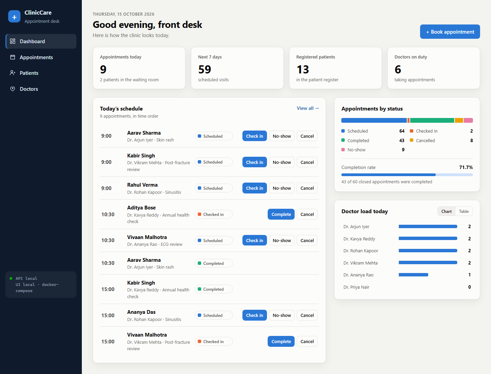

---

## Contents

- [What the application does](#what-the-application-does)
- [Architecture](#architecture)
- [Repository layout](#repository-layout)
- [Run it locally](#run-it-locally)
- [M1 Application](#m1--application) · [M2 Testing](#m2--testing) · [M3 Git](#m3--git-and-github) · [M4 Docker](#m4--docker)
- [M5 CI/CD](#m5--cicd-pipeline) · [M6 Trivy](#m6--devsecops-trivy) · [M7 Terraform](#m7--terraform-aws)
- [M8 Kubernetes + Helm](#m8--kubernetes--helm) · [M9 Observability](#m9--observability) · [M10 Live demo](#m10--live-demo)
- [Deploying to AWS end to end](#deploying-to-aws-end-to-end) · [Teardown](#teardown) · [Troubleshooting lab](#troubleshooting-lab)

---

## What the application does

| Area | Features |
|------|----------|
| **Dashboard** | Today's appointments, patients, active doctors, the week ahead, completion rate, a status breakdown and each doctor's load (chart or table) |
| **Appointments** | Book, reschedule, cancel. Visits move scheduled → checked in → completed. Overlap checks for both doctor and patient. Filters by date, status, doctor and patient |
| **Patients** | Register, edit, search by name or phone. A patient with appointment history can't be deleted |
| **Doctors** | Add, edit, deactivate. Inactive doctors can't be booked. Doctor emails are unique |
| **Look and feel** | Light and dark themes and a mobile layout. The footer shows which commit the UI and the API were built from |

Business rules live in the API, not the UI:

- **Status changes.** Only allowed moves are accepted; for example, a cancelled
  visit can't be completed.
- **Rescheduling.** Only scheduled visits can be rescheduled.
- **Conflicts.** A clash or a delete that would orphan records returns
  `409 Conflict` with a readable message.

---

## Architecture

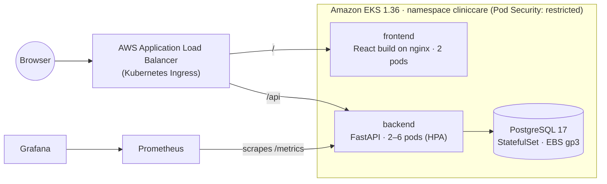

| Layer | Technology |
|-------|-----------|
| Frontend | React 19 + Vite 8, served by unprivileged nginx 1.30 |
| Backend | FastAPI, SQLAlchemy 2.1, Alembic migrations, Pydantic 2 |
| Database | PostgreSQL 17 |
| Tests and quality | pytest (35 tests, 88% coverage), ruff, Prettier, npm audit |
| Containers | Multi-stage Dockerfiles, non-root users, Docker Compose |
| CI/CD | GitHub Actions → GHCR (commit-SHA tags) → EKS via GitHub OIDC |
| Security | Trivy image scans (fail on fixable HIGH/CRITICAL), SHA-pinned actions, Dependabot |
| Infrastructure | Terraform 1.16, AWS provider 6, community VPC and EKS modules, `ap-south-1` |
| Kubernetes | Helm chart: Deployments, StatefulSet, Ingress (AWS Load Balancer Controller), HPA, PDB, NetworkPolicy |
| Observability | kube-prometheus-stack: Prometheus, Grafana, ServiceMonitor, alert rules, a provisioned dashboard |

---

## Repository layout

```text
backend/                 FastAPI app, Alembic migrations, tests, Dockerfile
  app/                   models, schemas, routers, metrics, migrate + seed entry point
  alembic/versions/      0001 doctors and patients, 0002 appointments
  tests/                 pytest suite (SQLite test database, never the real one)
frontend/                React app, nginx config template, Dockerfile
docker-compose.yml       postgres + one-shot migrate + backend + frontend
.github/                 CI/CD workflow and Dependabot config
terraform/               VPC, EKS, IAM (operator, admin role, GitHub OIDC, pod identities)
k8s/                     namespace (restricted Pod Security) and pipeline RBAC
helm/cliniccare/         the application chart (+ values-prod.yaml, values-kind.yaml)
monitoring/              kube-prometheus-stack values
scripts/                 AWS bootstrap, GitHub setup, load test, teardown, screenshots
troubleshooting/         five broken deployments and how to diagnose them
docs/                    screenshots and raw command output used as evidence
```

---

## Run it locally

Requirements: Docker with Compose v2.

```bash
docker compose up --build
```

| URL | What |
|-----|------|
| http://localhost:3000 | The application. nginx serves the UI and proxies `/api` to the backend |
| http://localhost:8000/docs | Interactive API documentation (Swagger UI) |
| http://localhost:8000/metrics | Prometheus metrics |

Compose starts PostgreSQL first and waits for its health check. A one-shot
`migrate` container then runs the Alembic migrations and loads demo data:
6 doctors, 12 patients and two weeks of appointments. The API and UI start
only after that container has finished successfully.

Run the backend tests without Docker:

```bash
cd backend
python -m venv .venv && . .venv/bin/activate     # Windows: .venv\Scripts\activate
pip install -r requirements-dev.txt
pytest -v
```

---

## M1 · Application

### API

| Method | Path | Purpose |
|--------|------|---------|
| GET | `/health` | Liveness: the process is up (`{"status": "UP"}`) |
| GET | `/ready` | Readiness: the database is reachable and migrated, otherwise 503 |
| GET | `/api/info` | Name, version, environment and the commit SHA the image was built from |
| GET · POST | `/api/doctors` | List (filters `specialty`, `active`) · create |
| GET · PUT · DELETE | `/api/doctors/{id}` | Read · update · delete (refused while appointments exist) |
| GET · POST | `/api/patients` | List with search `q`, `limit`, `offset` · register |
| GET · PUT · DELETE | `/api/patients/{id}` | Read · update · delete (refused while appointments exist) |
| GET · POST | `/api/appointments` | List with filters (`status`, `doctor_id`, `patient_id`, `day`, `from_day`) · book |
| GET · PUT · DELETE | `/api/appointments/{id}` | Read · reschedule or edit · delete |
| PATCH | `/api/appointments/{id}/status` | Check in, complete, cancel, mark no-show |
| GET | `/api/stats` | Dashboard figures |
| GET | `/metrics` | Prometheus metrics (excluded from the OpenAPI schema) |

### Database

Three tables (`doctors`, `patients`, `appointments`) are created only by
Alembic migrations. The schema is never built with `create_all`.

- **Constraints.** Foreign keys, a unique doctor email, and indexes for the
  doctor-schedule and status queries.
- **Migration test.** `tests/test_migrations.py` checks that the migrations
  produce exactly the schema the models describe. It also checks that they
  downgrade and upgrade again cleanly.
- **Running migrations.** In Kubernetes they run in an init container. A
  PostgreSQL advisory lock means only one pod migrates when several start at
  once.

| | |
|---|---|
| 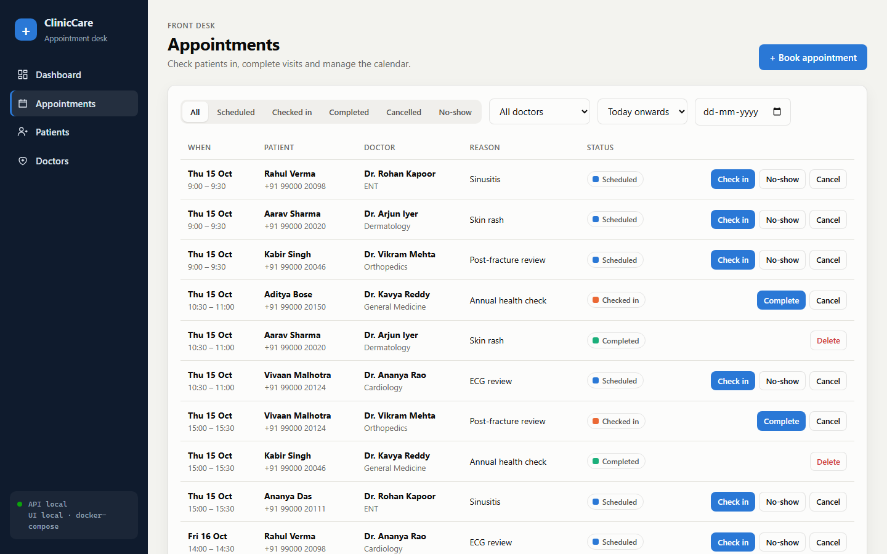 | 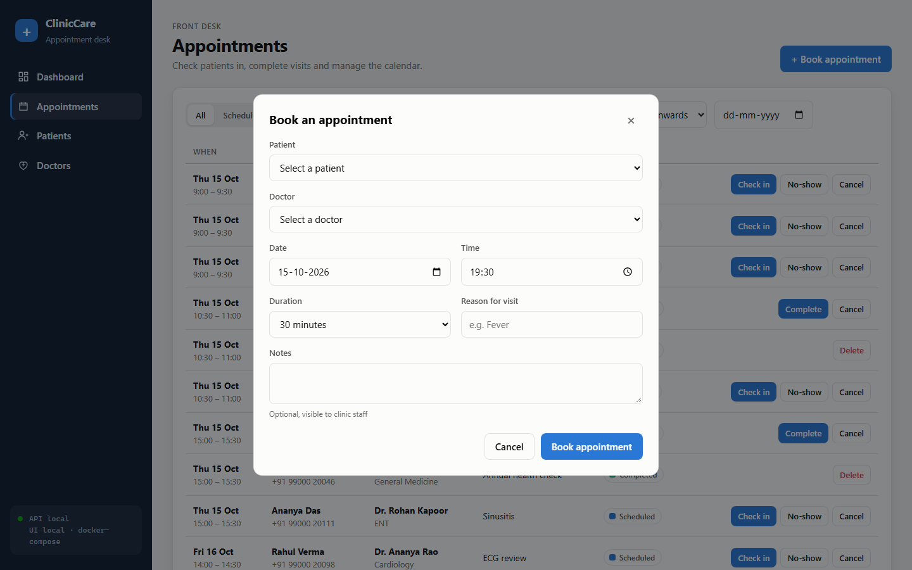 |
| 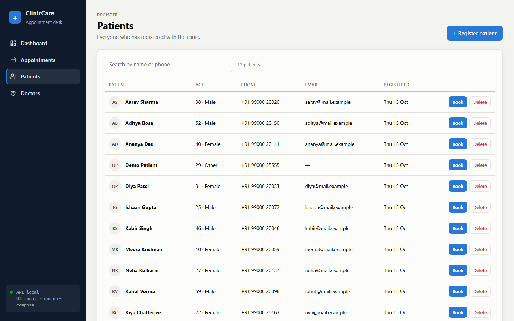 | 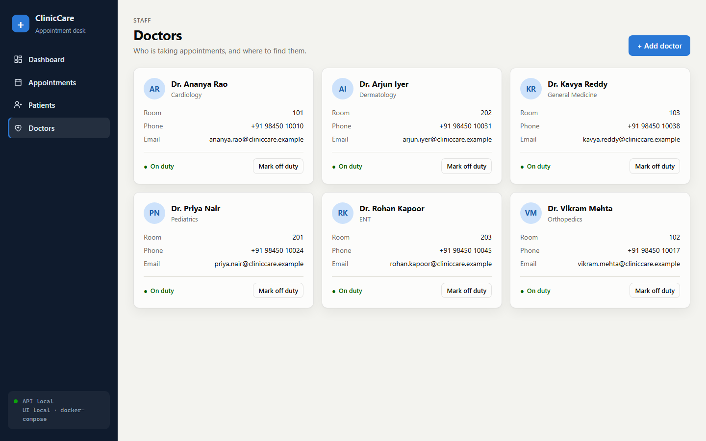 |
| 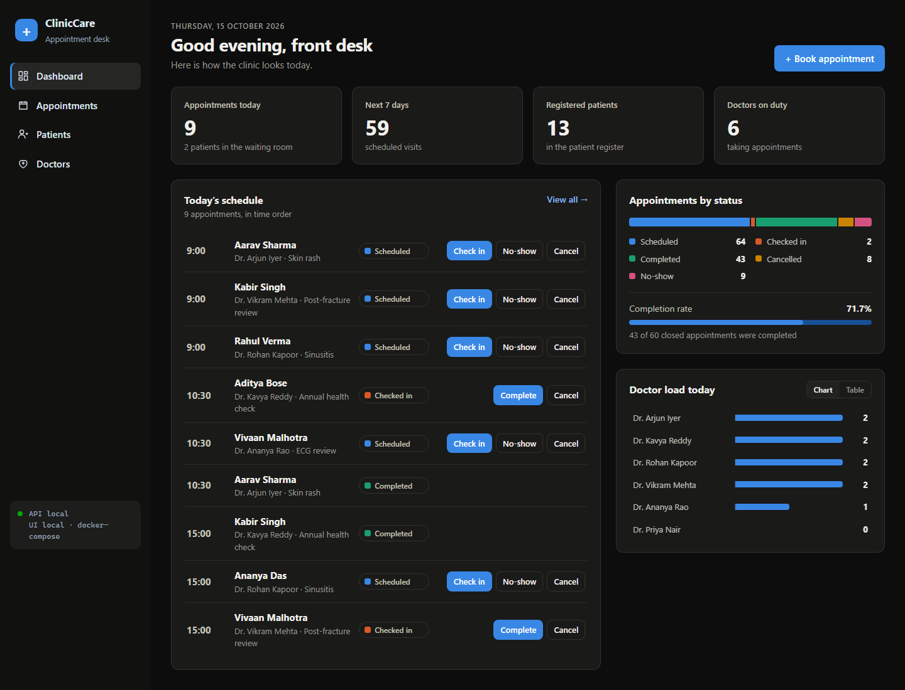 | 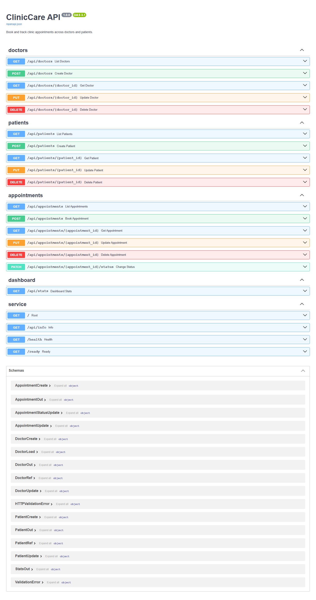 |

Mobile layout, the tables in PostgreSQL, and the API answering with curl:

<p>
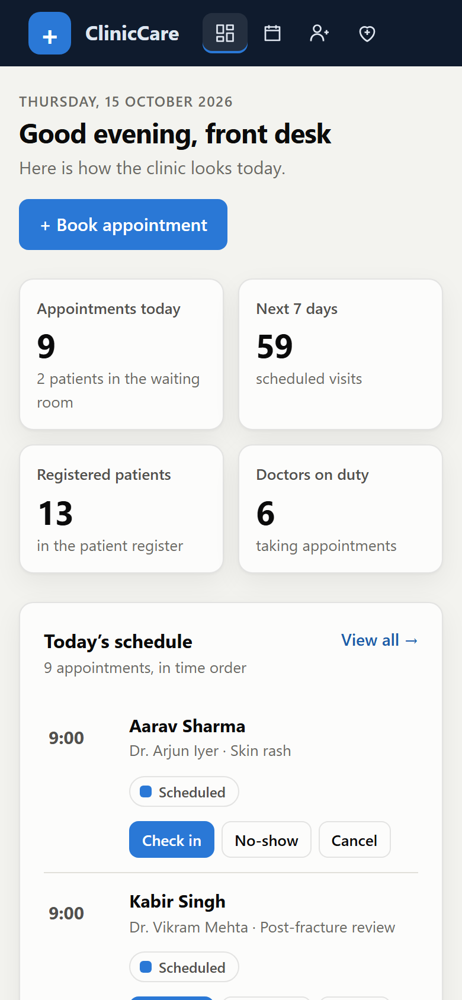
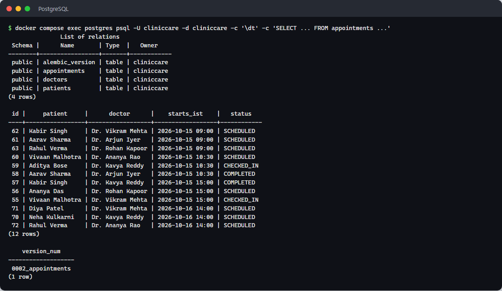
</p>

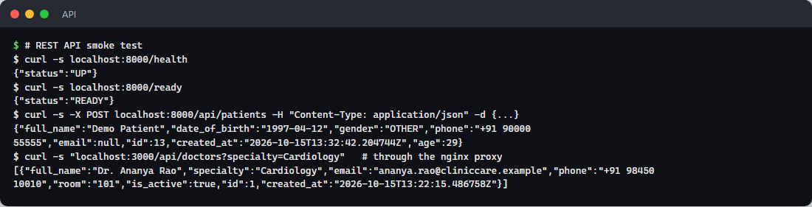

---

## M2 · Testing

There are 35 tests, and all pass. Coverage is 88%.
([`pytest.ini`](backend/pytest.ini), [`conftest.py`](backend/tests/conftest.py))

- **Test database.** `conftest.py` points `DATABASE_URL` at a temporary SQLite
  file before the app is imported. The schema is built by running the real
  Alembic migrations, and every test starts with empty tables. The suite never
  connects to PostgreSQL.
- **What the tests cover:** CRUD for all three resources; overlap rejection for
  doctors and patients; allowed and forbidden status transitions; validation
  errors (422); conflicts (409); missing records (404); dashboard statistics;
  the demo-data seeder; and the migration test described above.
- **Deprecations.** `pytest.ini` turns deprecation warnings raised from `app.*`
  into errors, so a deprecated API call fails the build instead of slipping by.
- **In CI.** The `Backend` job runs `ruff check` and `ruff format --check`,
  then pytest. A failure stops the pipeline before any image is built.

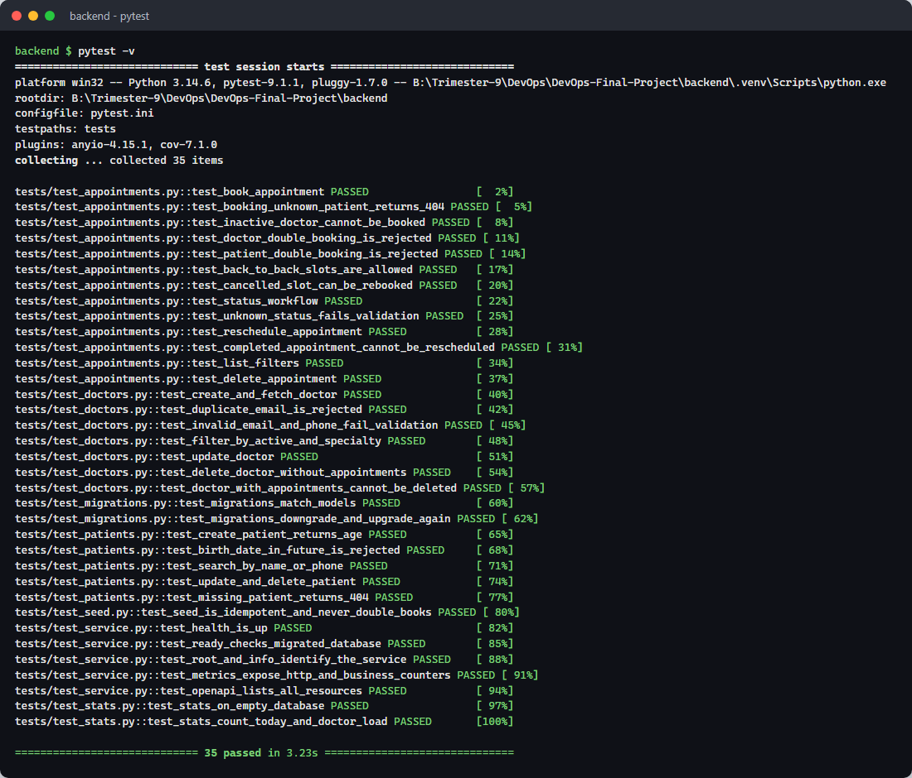

---

## M3 · Git and GitHub

- Public repository: https://github.com/Bhuvanesh66/cliniccare-devops
- One commit per meaningful step, with descriptive messages (`git log --oneline`).
- [`.gitignore`](.gitignore) excludes `.env*` (except `.env.example`),
  `__pycache__`, `node_modules`, `.venv`, Terraform state, plans and
  `*.tfvars`, and kubeconfig files.
- No credentials are committed:
  - The pipeline gets AWS access through GitHub OIDC, so there are no stored
    keys at all.
  - The operator key lives only in the local AWS CLI profile.
  - The AWS account ID is redacted from the committed Terraform plan output.

---

## M4 · Docker

| Image | Build | Runs as |
|-------|-------|---------|
| [`backend/Dockerfile`](backend/Dockerfile) | Two stages: dependencies are installed into a virtualenv, and only the venv and the app are copied into a slim runtime. pip is removed from the final image | uid 10001 (`app`) |
| [`frontend/Dockerfile`](frontend/Dockerfile) | Two stages: Node 24 runs `npm ci` and `vite build`; `nginx-unprivileged` serves the static files on port 8080 | uid 101 (`nginx`) |

Other details:

- **Pinned base images.** Base images are pinned by digest, so a rebuild uses
  exactly the same base.
- **Commit SHA.** Both images take `GIT_SHA` as a build argument. The running
  app can report which commit it is.
- **Health checks.** Each image has a `HEALTHCHECK`.
- **Backend URL.** The nginx `/api` upstream comes from `BACKEND_URL`, set by
  an envsubst template. The same image works under Compose (`backend:8000`)
  and in Kubernetes (`cliniccare-backend:8000`).

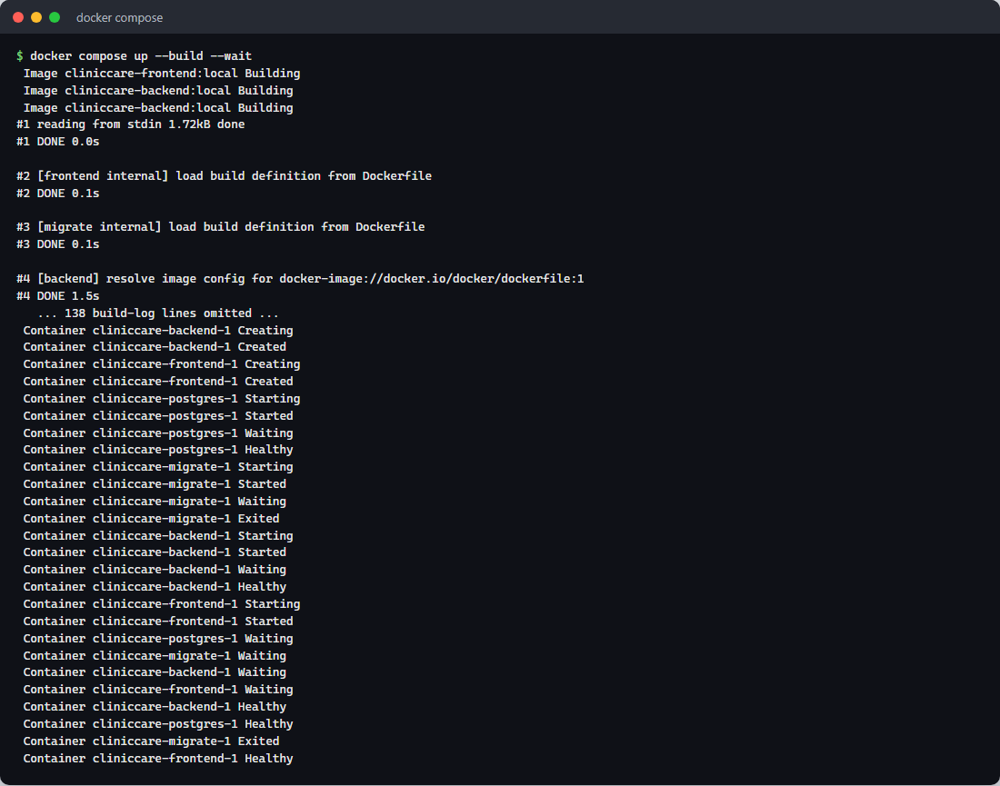
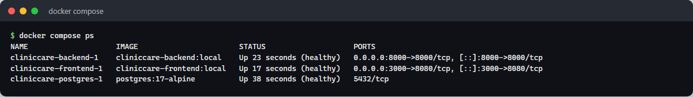
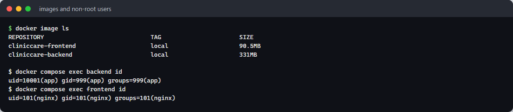

---

## M5 · CI/CD pipeline

[`.github/workflows/ci-cd.yml`](.github/workflows/ci-cd.yml) runs on every
push and pull request to `main`, and on manual dispatch.

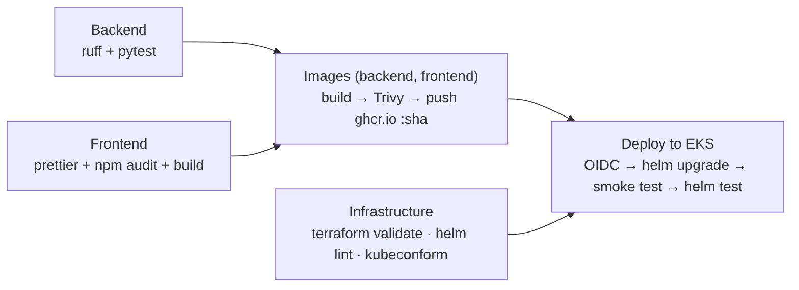

| Job | What it proves |
|-----|----------------|
| **Backend** | Lint passes and all tests pass. A failure stops everything after it |
| **Frontend** | Formatting is clean, there are no high-severity npm advisories, and the production build succeeds |
| **Infrastructure** | `terraform fmt` and `terraform validate` pass; the Helm chart lints and renders; every manifest validates against the Kubernetes 1.36 schemas with kubeconform |
| **Image** (×2) | See below |
| **Deploy to EKS** | See below |

The **Image** job (one per component):

- Builds `ghcr.io/bhuvanesh66/cliniccare-<component>:<commit SHA>`. Images are
  never tagged `latest`.
- Scans it with Trivy.
- Pushes it to GHCR, only on `main` and only if the scan passes.

The **Deploy to EKS** job:

- Assumes an AWS role through GitHub OIDC.
- Runs `helm upgrade --install --wait --rollback-on-failure` with the new SHA.
- Waits until the public URL serves that exact commit, then runs `helm test`.

The deploy job runs only while a cluster exists.
`scripts/configure-github.sh` sets the repository variable
`DEPLOY_ENABLED=true` after the cluster is created, and teardown sets it back
to `false`. Between lab sessions the pipeline stays green without an AWS bill.

Supply-chain hygiene:

- Every third-party action is pinned to a full commit SHA. Tags can be moved,
  as happened to `trivy-action` in March 2026.
- Workflow permissions default to `contents: read`.
- Dependabot opens weekly update PRs for pip, npm, base images, actions and
  Terraform.

Green runs: <https://github.com/Bhuvanesh66/cliniccare-devops/actions>. Published images: <https://github.com/Bhuvanesh66?tab=packages&repo_name=cliniccare-devops>.

---

## M6 · DevSecOps: Trivy

Each image is scanned in the pipeline before it can be pushed:

- `severity: HIGH,CRITICAL`, `ignore-unfixed: true`, `exit-code: 1`
- Trivy v0.75.0, through `trivy-action` pinned to the v0.36.0 commit

**What Trivy scanned.** It inspected every layer of the built image:

- the Debian 13 OS packages in the backend's base image, and the Alpine
  packages in the frontend's nginx image
- every Python package installed in the backend's virtualenv

It compared their versions with its vulnerability database. If a HIGH or
CRITICAL vulnerability has a released fix, the job fails and the image is
never pushed to GHCR.

**What it found, and the fix.** The first scan of the backend image
([before](docs/evidence/trivy-backend-before.txt)) failed with 4 HIGH findings.
None came from the application's own dependencies. All four were copies that
**pip** bundles inside itself:

- `msgpack` GHSA-6v7p-g79w-8964: out-of-bounds read
- `setuptools` CVE-2025-47273: path traversal in `PackageIndex`, so a malicious
  package URL could write files outside the download directory
- `urllib3` CVE-2026-97687 and CVE-2026-97689: HTTPS proxy interception, and
  unbounded memory in the chunk parser

pip is only needed to *install* packages, never to run the API. So the
Dockerfile now uninstalls pip from the final image. The rescan
([after](docs/evidence/trivy-backend-after.txt)) reports **0
vulnerabilities**. The frontend image passes the same gate.

The lesson: the image shipped tools it didn't need, and each one is attack
surface. Removing them fixed the finding instead of suppressing it.

---

## M7 · Terraform (AWS)

[`terraform/`](terraform) provisions everything in **ap-south-1 (Mumbai)**.
Running `terraform plan` gives *72 to add*
([full plan](docs/evidence/terraform-plan.txt),
[summary](docs/evidence/terraform-plan-summary.txt)).

| File | Contents |
|------|----------|
| `versions.tf` | Terraform ≥ 1.10, AWS provider 6.x, default tags on every resource |
| `variables.tf` | Region, CIDR, Kubernetes version, node sizes, the GitHub repo allowed to deploy |
| `main.tf` | VPC (module 6.7.3) and EKS (module 21.29.0) |
| `iam.tf` | Operator user, admin role, GitHub OIDC deploy role, pod-identity roles for the EBS CSI driver and the Load Balancer Controller |
| `outputs.tf` | Cluster name, endpoint, VPC/subnet IDs, role ARNs, the `kubectl` setup command |
| `terraform.tfvars.example` | The variables you can override. Real `*.tfvars`, state and plans are git-ignored |

**Network.**

- VPC `10.20.0.0/16` across two availability zones.
- **2 public subnets** hold the load balancer and the NAT gateway.
- **2 private subnets** hold the worker nodes.
- One NAT gateway, to keep costs down.
- Subnets carry the `kubernetes.io/role/elb` tags the Load Balancer Controller
  needs.

**Cluster.**

- EKS **1.36** on the *standard* support policy; older versions bill extended
  support at 6× the price.
- One managed node group: 3 × t3.medium, AL2023, scaling 2–4.
- Managed add-ons: VPC CNI with network-policy enforcement, CoreDNS,
  kube-proxy, Pod Identity agent, EBS CSI driver (gp3 as the default
  StorageClass) and metrics-server.

**Access without long-lived secrets.**

| Who | How they reach the cluster | Kubernetes permissions |
|-----|---------------------------|------------------------|
| Me (operator) | IAM user `cliniccare-operator` → assumes `cliniccare-eks-admin` | Cluster admin (EKS access entry) |
| GitHub Actions | OIDC token, trusted only for this repo's `production` environment → `cliniccare-github-deploy` | Admin of the `cliniccare` namespace only, plus RBAC for ServiceMonitors and alert rules |
| AWS Load Balancer Controller, EBS CSI | EKS Pod Identity | — |

The cluster uses the `API` authentication mode (access entries, no `aws-auth`
ConfigMap). Nothing gets cluster admin implicitly, not even the identity that
ran Terraform.

**Cost.**

- About **$0.30 per hour** while it runs: EKS control plane $0.10, three
  t3.medium nodes, the NAT gateway and the ALB.
- The cluster is created for demos and screenshots and destroyed straight after.

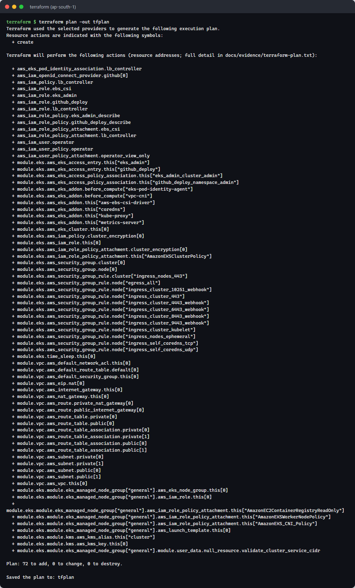

---

## M8 · Kubernetes + Helm

[`k8s/namespace.yaml`](k8s/namespace.yaml) creates the `cliniccare` namespace.
It **enforces the restricted Pod Security Standard**: no root, no privilege
escalation, all capabilities dropped, seccomp on. Every ClinicCare pod complies.

The [`helm/cliniccare`](helm/cliniccare) chart deploys the following.

**Workloads.**

- **backend:** a Deployment with ≥ 2 replicas.
  - An init container runs the migrations first.
  - Startup, liveness (`/health`) and readiness (`/ready`) probes.
  - A read-only root filesystem.
- **frontend:** a Deployment with 2 replicas, read-only, with nginx writing
  only to `emptyDir` volumes.
- **postgres:** a StatefulSet with a 5 Gi gp3 volume.

**Networking.**

- **Services:** ClusterIP `cliniccare-backend:8000`,
  `cliniccare-frontend:80` and `cliniccare-postgres:5432`.
- **Ingress:** `ingressClassName: alb`, internet-facing. It routes `/api` to
  the backend and `/` to the frontend. The AWS Load Balancer Controller turns
  it into an Application Load Balancer that targets pod IPs directly.

**Scaling and resilience.**

- **HPA:** the backend scales from 2 to 6 replicas at 60% CPU.
- **PodDisruptionBudgets:** node drains never take all replicas at once.
- **NetworkPolicy:** only backend pods may reach PostgreSQL.

**Secrets.** The database password is generated randomly on first install and
kept on every upgrade. It is never in Git or in `values.yaml`.

**Helm tests.** A `helm test` smoke-test pod calls the backend's `/ready` and
`/api/stats` through its Service. It also loads the UI, and calls `/api/info`
through the frontend's nginx proxy.

```bash
helm upgrade --install cliniccare ./helm/cliniccare -n cliniccare \
  -f helm/cliniccare/values-prod.yaml --set image.tag=<commit-sha> --wait
kubectl -n cliniccare get pods,svc,ingress,hpa
helm list -n cliniccare
```

The chart also installs on a local kind cluster with `values-kind.yaml`, which
uses locally loaded images and no Ingress.

**Load test.** `scripts/load-test.sh` starts an in-cluster k6 job that ramps up
to 40 virtual users, then watches the HPA add backend replicas.

---

## M9 · Observability

**What the backend exposes.** `/metrics` serves Prometheus metrics from
`prometheus-fastapi-instrumentator`:

- request counts and latency histograms, labelled by route template, method
  and status class
- two business counters: `cliniccare_appointments_booked_total{specialty}` and
  `cliniccare_appointment_status_changes_total{status}`

Probe endpoints are excluded so they don't drown out real traffic.
[Sample output](docs/evidence/metrics-local.txt).

**What's installed.** [`monitoring/kube-prometheus-stack-values.yaml`](monitoring/kube-prometheus-stack-values.yaml)
installs Prometheus, Grafana, the Prometheus Operator, kube-state-metrics and
node-exporter:

- The Grafana admin password is random, stored in a Secret, and never in a
  values file.
- Scrape jobs for control-plane parts that EKS hides are turned off, so the
  Targets page only shows targets that can actually be UP.

**What the chart adds** (`values-prod.yaml` turns these on):

- a **ServiceMonitor**, so Prometheus scrapes every backend pod every 15 s
- **PrometheusRules** for *API down*, *5xx error rate above 5%* and
  *p95 latency above 1 s*
- the **ClinicCare Grafana dashboard**
  ([JSON](helm/cliniccare/dashboards/cliniccare.json)), loaded automatically by
  the Grafana sidecar. Its 12 panels cover:
  - traffic: request rate (total and per endpoint) and responses by status class
  - errors and speed: 5xx error rate, p95 latency and latency percentiles
  - pods: API pods up, CPU per pod, and the autoscaler's replica count
  - bookings: appointments booked, bookings by specialty, and status changes

```bash
kubectl -n monitoring port-forward svc/kube-prometheus-stack-prometheus 9090   # → Status › Targets
kubectl -n monitoring port-forward svc/kube-prometheus-stack-grafana 3000:80   # → Dashboards › ClinicCare
kubectl -n monitoring get secret grafana-admin -o jsonpath='{.data.admin-password}' | base64 -d
```

---

## M10 · Live demo

1. Change something visible, for example the subtitle in
   `frontend/src/App.jsx`. Commit it and push to `main`.
2. In GitHub Actions, watch the jobs run in order: tests and lint → images
   built, scanned and pushed as `:<sha>` → **Deploy to EKS**.
3. The deploy job prints the load balancer URL and only turns green once that
   URL serves the new commit.
4. Refresh the browser. The change is live, and the footer shows the new
   commit for both the UI and the API.
5. If the new version fails its readiness checks, `--rollback-on-failure`
   restores the previous release automatically.

---

## Deploying to AWS end to end

The tools you need:

- Terraform ≥ 1.10
- AWS CLI v2
- kubectl
- Helm 4
- the GitHub CLI (`gh`), logged in
- AWS credentials with administrator rights (for example `aws login`)

```bash
# 1. Infrastructure (~15 minutes)
cd terraform
terraform init
terraform plan -out tfplan
terraform apply tfplan
cd ..

# 2. A CLI profile for the operator IAM user (the key lives only in ~/.aws/credentials)
scripts/setup-operator-profile.sh

# 3. kubeconfig, namespace, AWS Load Balancer Controller, Prometheus + Grafana
scripts/bootstrap-cluster.sh

# 4. GitHub: "production" environment + variables, enables the deploy job
scripts/configure-github.sh

# 5. Deploy: push to main, or re-run the latest workflow
gh workflow run ci-cd.yml
```

## Teardown

```bash
scripts/teardown.sh
```

The order matters, and the script follows it:

1. Uninstall the app, which deletes the Ingress. The controller then deletes
   the ALB.
2. Wait until the ALB is really gone. It holds network interfaces in the VPC
   that would block deleting the VPC.
3. Remove the monitoring stack and the controller, and delete any remaining
   volumes.
4. `terraform destroy`.
5. Switch the deploy job off.

Afterwards there is no EC2 instance, EBS volume, load balancer, NAT gateway or
Elastic IP left running.

---

## Troubleshooting lab

[`troubleshooting/`](troubleshooting) contains five deliberately broken
deployments:

- an image pull failure
- a Service with no endpoints
- a pod that never becomes Ready
- a crash loop
- a Pod Security rejection

For each one, [its README](troubleshooting/README.md) gives the symptom, the
`kubectl` commands that reveal the cause, and the fix.

```bash
troubleshooting/run-scenario.sh 4         # break it and print the diagnosis
troubleshooting/run-scenario.sh cleanup
```
